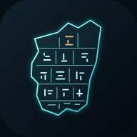

# PALERMO — Каменная летопись

[Открыть приложение](https://evgk724.github.io/palermo-stone/) · [Автономный HTML](https://evgk724.github.io/palermo-stone/PALERMO.html)

Интерактивный атлас Палермского камня на русском языке. Тёмный фон, неоновые линии реальной исторической прорисовки, крупный регулируемый текст и повторение по памяти.



## Возможности

- Оборотная сторона камня по прорисовке Édouard Naville, 1903, таблица II B. Неоновый фильтр, исходная копия, увеличение 1–4×, перетаскивание, клавиши со стрелками и развёрнутый просмотр.
- Схема «царь → события года → уровень Нила», конкретные записи о кораблях Снофру, разливе и поступлениях из дальних земель.
- Объяснение материала, места хранения, размеров и датировки; разбор технической возможности тонкой ручной резьбы.
- Разбор четырёх временных отметок ролика Proto Civilization «Палермский камень». Разделены увиденное в кадре, авторская размерная разметка и вывод. Кадры и расшифровка ролика не перепубликуются.
- 16 карточек: сначала вспомнить, затем открыть ответ. «Ещё раз» возвращает карточку через 10 минут. «Вспомнил» — через 1, 3, 7, 14 и 30 дней. Прогресс появляется только после реального действия пользователя и хранится в браузере.
- Три размера текста, адаптация к телефону и планшету, оригинальная иконка, QR-код.
- Проверка обновлений при открытии, возвращении и раз в минуту, пока страница открыта. Текущая карточка не прерывается. Размер текста и прогресс сохраняются. Проверка и переключатель находятся в «О приложении».
- Самостоятельный файл `PALERMO.html` работает без сети. Для внешних источников и YouTube нужен интернет. Установленная веб-версия не обещает офлайн-кэш: для автономного чтения сохраните HTML.

## Установка на iPhone и iPad

Откройте ссылку в Safari. В меню «Поделиться» выберите «На экран “Домой”». Настройте размер текста переключателем вверху страницы. Прогресс разных браузеров и устройств автоматически не синхронизируется.


## Содержание и границы выводов

Исследования определяют породу как чёрный оливиновый базальт. Некоторые знаки действительно занимают всего несколько миллиметров. Ручная тонкая резьба по твёрдым породам технически возможна, но конкретный инструмент, полная последовательность и время изготовления Палермского камня не установлены рассмотренными работами. Эксперименты с другими предметами не названы точной реконструкцией этого памятника.

Размер знака, ширина линии и глубина бороздки — разные величины. Плавность контура не измеряет скорость резчика. Аналогия с выжиганием дерева в видео не является экспериментом по базальту. Для каждого вывода в приложении доступны источники. Их полный список находится в `sources.json`.

Высота и ширина округлены из обмера Wilkinson (43,5 × 25 см; толщина 5,1–6,5 см). Другие авторы приводят несколько иные приблизительные размеры. Основной фрагмент хранится в музее Антонино Салинаса в Палермо. В научной публикации пять связанных фрагментов приписаны Египетскому музею Каира, один — Музею Питри (UC 15508); размещение каирских фрагментов в текущих витринах не подтверждалось.

Обычно памятник связывают с V династией, но время событий и нанесения сохранившейся записи не тождественны. Не все аспекты общей реконструкции семи фрагментов бесспорны.

## Графика и происхождение

Основной источник: Édouard Naville, *La pierre de Palerme*, *Recueil de travaux* 25 (1903), таблица II B. Скан Harold B. Lee Library / Internet Archive. Общественное достояние. [Оригинальная публикация](https://archive.org/details/recueildetravaux25masp/page/n75/mode/1up), [библиографическая запись IFAO](https://www.ifao.egnet.net/bases/beo/beo5012).

`naville-1903-verso-source.png` сохранён внутри `neon-verso.svg` без изменения данных изображения. SVG-фильтр подавляет фон бумаги и окрашивает исторические линии; потерянные знаки не дорисовываются. Это историческая прорисовка, а не микроскопическая карта или окончательное современное прочтение. Неон можно выключить. Точное происхождение и контрольная сумма — в `docs/assets/assets-provenance.json`.

Иконка — новая графическая схема фрагмента с условными насечками. Учебная схема анналов в интерфейсе не выдается за дословный перевод выбранного участка. В ролике преимущественно показана лицевая сторона, в неоновом просмотре — оборотная.

## Сборка

```sh
python3 scripts/build.py
python3 -m http.server 8769 --bind 127.0.0.1
```

Локальный адрес: `http://127.0.0.1:8769/docs/`. Для сборки достаточно стандартной библиотеки Python. Для повторного изготовления QR нужны ReportLab и Pillow; для PNG-иконок — Node.js и Playwright. Все готовые файлы находятся в репозитории, внешние ресурсы во время работы приложения не загружаются.

```sh
node tests/learning.cjs
node tests/browser.cjs
node tests/updater.cjs
```

Для браузерных тестов установите Playwright и запустите локальный сервер. При нестандартном расположении модуля можно задать `PLAYWRIGHT_MODULE`. `APP_URL` в тесте браузеров позволяет проверить опубликованный сайт; автономный файл проверяется локально.

Браузерная проверка включает Chromium и WebKit, 7 размеров экрана (320–1440 CSS-пикселей), 3 размера текста, увеличение, диалоги, сохранение карточек и обновление без прерывания повторения. Это эмуляция браузеров, не испытание на физических устройствах.

GitHub Pages публикует `docs/` из ветки `main`. Контентный идентификатор выпуска в `version.json` обновляется сборкой. Приложение не использует стороннюю аналитику и серверную базу пользовательского прогресса.

## Лицензии

Новый код, тексты приложения, схемы и иконка: MIT (см. `LICENSE`). Историческая прорисовка находится в общественном достоянии. Внешние исследования и видео сохраняют права своих авторов; ссылки не меняют их лицензию.
